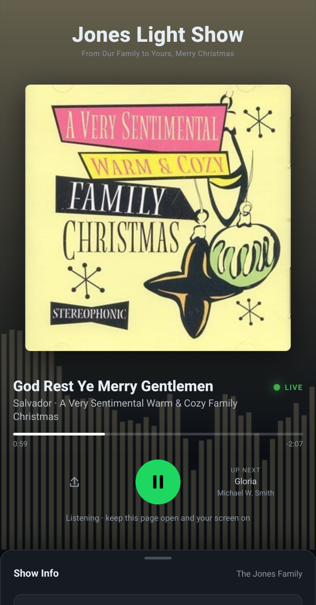
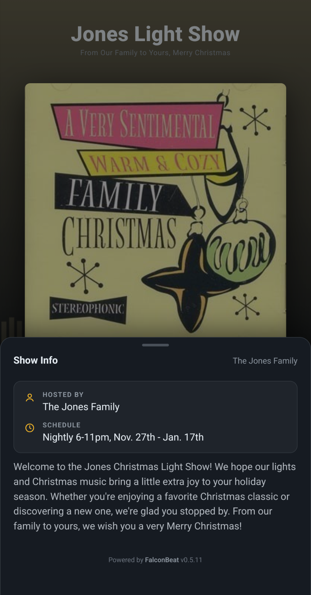

# FalconBeat

Self-hosted synchronized audio for [Falcon Player](https://github.com/FalconChristmas/fpp)
(FPP) light shows. Visitors open a webpage on their devices and hear the show
audio in sync with the lights — from anywhere on the internet, not just the
show Wi-Fi.

Everything runs on hardware you own: one Docker container on your LAN serves
the listener page, hosts the audio, and keeps every device's playback locked to
the same clock. The only outside piece is whatever HTTPS ingress you choose
(a Cloudflare Tunnel, a reverse proxy, a VPS — anything).

Device-side sync is powered by [BeatSync](https://github.com/freeman-jiang/beatsync)
(MIT © freeman-jiang), vendored as an unmodified submodule. The FPP side is
driven by the companion plugin
**[fpp-plugin-FalconBeat](https://github.com/GraphicHealer/fpp-plugin-FalconBeat)**.

<p align="center">
  
  
</p>

## Requirements

- A Docker host on the **same LAN as the FPP controller** — any Linux box,
  Pi, or NAS (amd64 or arm64)
- FPP with **[fpp-plugin-FalconBeat](https://github.com/GraphicHealer/fpp-plugin-FalconBeat)**
  installed (FPP → Content Setup → Plugin Manager → paste the repo URL)
- Public HTTPS ingress to the container's edge port. A
  [Cloudflare Tunnel](https://developers.cloudflare.com/cloudflare-one/connections/connect-networks/)
  is the easy path — free, no port-forwarding — but anything that gives the
  page a public HTTPS URL works (devices require HTTPS for WebAudio).

## Quick start

```bash
cd deploy
cp .env.example .env          # set FALCONBEAT_TOKEN
docker compose up -d          # pulls the CI-built image from GHCR
```

Generate one shared secret — it's the plugin's admin auth, the ingest
Bearer token, and the `/upload/complete` gate all in one:

```bash
openssl rand -hex 32    # → FALCONBEAT_TOKEN
```

On Windows/PowerShell: `[guid]::NewGuid().ToString('N') + [guid]::NewGuid().ToString('N')`.

To build locally instead of pulling: `docker compose up -d --build`.

The published image is `ghcr.io/graphichealer/falconbeat` (amd64 + arm64),
built by `.github/workflows/docker.yml` on every GitHub **release** — tags like
`0.5.11`, `0.5`, `latest`. Verify it's up:

```bash
curl http://localhost:8000/health    # {"status":"ok"} through the edge
docker compose logs -f               # interleaved logs from all three processes
```

One container runs everything: BeatSync (Bun), the ingest service, and
Caddy — and **one published port** carries it all. Caddy routes by path and
method: listeners get the page, `/ws`, and `/media` audio; the plugin
reaches its admin socket, `/upload/complete`, and ingest writes through the
same port with the token as a Bearer gate. BeatSync's `:8080` and ingest's
`:8090` stay inside the container — nothing else is published.

### Ports

| Port | Exposure | Purpose |
|---|---|---|
| `8000 → 80` | tunnel target **and** the plugin's URL | Listener page, `/media` audio, `/ws` WebSocket, token-gated ingest writes + `/upload/complete` |

## Public ingress (cloudflared)

Create a tunnel (Cloudflare Zero Trust → Networks → Tunnels) and point a
hostname at the edge port:

```yaml
# cloudflared config.yml — see deploy/cloudflared.config.example.yml
tunnel: <tunnel-id>
credentials-file: /path/to/credentials.json
ingress:
  - hostname: falconbeat.example.com
    service: http://localhost:8000
  - service: http_status:404
```

Or run cloudflared as a sidecar container — a commented-out service is in
`deploy/docker-compose.yml` (set `CLOUDFLARED_TOKEN` in `.env`).

## Plugin settings (FPP → Input/Output Setup → FalconBeat)

**Connection:**

| Plugin field | Value |
|---|---|
| Server (LAN) | `http://<docker-host>:8000` — the one published port; the plugin derives the WebSocket address from it |
| Server Token | `FALCONBEAT_TOKEN` from `deploy/.env` — the single shared secret |

**Show Info** — what visitors see (pushed to the server on every change):

| Plugin field | Value |
|---|---|
| Show Name | Defaults to FPP's HostName |
| Tagline | Defaults to FPP's HostDescription |
| Hosted By / Schedule / Location | Shown in the Show Info sheet |
| Description | A paragraph about the show (custom multiline row) |
| Links | One per line: `Label = https://url` — rendered as pills |
| Public Listener URL | The https address visitors open — feeds the **Signage QR** at the bottom of the settings page |

**Sync tuning** (defaults are sane — don't touch unless timing is off):

| Plugin field | Value |
|---|---|
| Sync Offset | Shifts where devices join the track — raise it if the audio trails the lights, lower it if it runs ahead |
| Extra Delay | `0` = auto; manual nudge added to the computed schedule delay |
| Disconnect grace | How long the admin socket is held after playlist stop |

## The listener page

A fullscreen now-playing view: the show name and tagline up top, big album
art (extracted from each audio file's embedded tags — no external APIs),
title/artist/album with a LIVE badge, a progress bar, share + play/pause
controls, an "Up next" card, listener count, and a live spectrum
visualization tinted by the album art behind it all. A **Show Info** sheet
peeks up from the bottom edge — drag it open for the hosted-by, schedule,
location, description, and links pushed from the FPP plugin.

The page publishes Media Session metadata, so Android/iOS show the track in
the notification shade and lockscreen with working pause buttons.

When the show goes off air the display clears within a few seconds; if it
stays off air ~15s, joined listeners disconnect back to the play button and
can tap in again when the show resumes.

**Show info is configured in the FPP plugin** — the plugin pushes it to
`media/show.json` on every settings change. There is no web settings page;
the FPP plugin is the single source of truth.

## Media lifecycle

1. Plugin `PUT`s each track to ingest → file lands in `media/`
2. Ingest extracts embedded metadata into sidecars: `<file>.art.jpg|png`
   (album art) and `<file>.tags.json` (title/artist/album — the page prefers
   these over FPP-reported tags)
3. Plugin registers the track's `/media` URL with BeatSync
   (`/upload/complete`, Bearer-gated at the edge) and sends PLAY/PAUSE over
   the admin socket — devices preload on registration, and PLAY carries the
   FPP position + expected delay so everything fires on one scheduled
   timestamp. FPP callbacks are fire-and-forget: a device that joins mid-
   track lands at the right offset rather than holding the show. URLs are
   relative, so devices always fetch audio from whatever origin they loaded
   the page from — LAN and tunneled listeners alike
4. When a track finishes, the plugin evicts it from the room queue and deletes
   it (plus its sidecars) off `media/` — the volume doesn't fill up

`media/nowplaying.json` is pushed per track/stop event
(`{playing, title, artist, album, filename, next, updatedAtMs}`); the page
polls it for track info, up-next, and off-air state (`updatedAtMs` stale
>90s counts as off air).

## Repo layout

```
beatsync/   upstream BeatSync server, pinned submodule @ 94c38ab (unmodified)
web/        Vite + React listener page (vendored @beatsync/shared)
ingest/     zero-dep file receiver → media/ (runs on Bun in the container)
bridge/     Node CLI admin client — protocol reference + manual test tool
media/      audio store (volume-mounted; show audio is git-ignored)
deploy/     Dockerfile, entrypoint.sh, Caddyfile, docker-compose.yml, env examples
unraid/     Unraid CA template + notes
```

## Development

```bash
# listener page
cd web && npm install && npm run dev

# server (non-demo, no S3 needed)
cd beatsync && bun install && cd apps/server && CREATOR_SECRET=... bun src/index.ts

# ingest
cd ingest && MEDIA_DIR=../media INGEST_TOKEN=... node server.ts   # or bun server.ts

# bridge (manual push/play against a running server)
cd bridge && cp .env.example .env
node --env-file=.env src/cli.ts push "Song.mp3" && node src/cli.ts play "<publicUrl>"
```

See `AGENTS.md` for the protocol details, timing math, and operational quirks.

## Caveats

- Room→track registrations are in-memory — after a container restart the
  plugin re-registers on its next media event; files in `media/` persist.
- `/upload/complete` and `/discover` are unauthenticated inside BeatSync —
  the Caddyfile Bearer-gates them; keep `FALCONBEAT_TOKEN` strong since the
  gate is the only thing between them and the public internet. Ingest
  writes are token-protected by ingest itself.
- BeatSync's S3 backup/restore is disabled in the image (no R2 in this
  deployment); room state is in-memory by design.

## License & attribution

Device-side synchronization uses [BeatSync](https://github.com/freeman-jiang/beatsync)
by freeman-jiang, vendored unmodified under the MIT License — see
`beatsync/LICENSE`.
